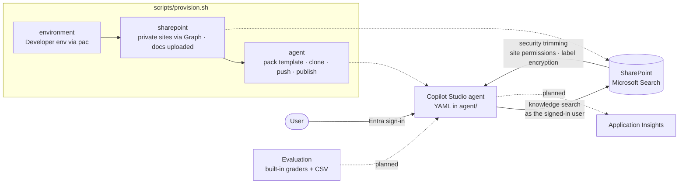

# copilot-studio-agent

A **Microsoft Copilot Studio** agent over your own SharePoint documents, defined as code and
provisioned with one script. Ask a question, get an answer with cited source files, drawn only from
what the **signed-in user** is allowed to see. It is the Copilot Studio counterpart of
[azd-foundry-search-agent](https://github.com/Metafiziks/azd-foundry-search-agent): same sample
corpus, same eval cases, same protected-mode idea, different platform.

> **Status.** Provisioning (verified end to end on a fresh environment), the sample corpus,
> two-level access restriction and the tests are done and were exercised against a real tenant. The
> evaluation runner is built and unit-tested, with its first live results pending. Memory,
> observability and CI/CD are **planned, not built**; each section below says exactly where it stands.

## Architecture



The agent runs entirely inside Copilot Studio: there is no code to host. Its instructions, settings
and knowledge sources are YAML under `agent/`, synced with `pac copilot`.

**SharePoint is the source of truth.** Retrieval runs under the signed-in user's identity, so site
permissions and encrypted sensitivity labels decide what an answer can draw on. See
[protected mode](guides/purview.md).

## Quick start

**Prerequisites:** the [Power Platform CLI](https://learn.microsoft.com/power-platform/developer/cli/introduction)
(`pac`, version with `pac copilot`; 2.16 worked) and its .NET runtime, the
[Azure CLI](https://learn.microsoft.com/cli/azure/install-azure-cli), Python 3.10+, and a Microsoft 365
tenant with SharePoint Online. Setup details are in [guides/setup.md](guides/setup.md).

```bash
git clone https://github.com/Metafiziks/copilot-studio-agent && cd copilot-studio-agent
pac auth create --deviceCode --tenant <tenant-id>
az login --tenant <tenant-id> --allow-no-subscriptions     # sign in as the SAME identity
cp .env.example .env                                         # set SP_HOST at minimum
bash scripts/provision.sh --dry-run                          # preview every step
bash scripts/provision.sh
```

| Stage | What happens |
|---|---|
| Preflight | Checks `pac`, `az`, Python and both sign-ins |
| Environment | Creates a Developer environment if missing |
| SharePoint | Creates a private site (a Microsoft 365 group) through Graph, converts `docs/` to `.docx`, uploads it |
| Agent | Creates the agent from the template if missing, binds `agent/`, renders the SharePoint knowledge sources, pushes and publishes |
| Next steps | Prints what a script cannot do: sharing the agent and applying labels |

Then share the agent (Copilot Studio → Share) and **wait for SharePoint to index the new site**,
roughly 20 to 30 minutes, before asking questions.

Tear down:

```bash
bash scripts/teardown.sh --yes --delete-environment
```

Groups are deleted **and purged**; otherwise Entra reserves the site name for 30 days.

## Bring your own documents

Replace `docs/` with your own `.txt` files, adjust the instructions in `agent/agent.mcs.yml`, update
`tests/eval_cases.json`, and re-run `bash scripts/provision.sh`. SharePoint knowledge accepts
`.docx`, `.pdf`, `.pptx` and `.xlsx` (not `.txt`), so text files are converted on upload and cited as
`.docx`. Or skip `docs/` and put those formats straight into the SharePoint library. Sample mode lets
every member of the site read the documents; for internal knowledge bases use
[protected mode](guides/purview.md): per-user trimming by site permission and by encrypted
sensitivity label.

## Evaluations

**Status: runner built and unit-tested; no results from a fully indexed agent yet.**
`tests/eval_cases.json` holds the same 13 cases as the Azure template (12 RAG cases with expected
keywords and sources, one two-turn memory case), with source names mapped to `.docx`.

**Deterministic metrics** (keyword recall, citation recall, p95 latency, failed calls) run from a
script that calls the agent as a signed-in user through Microsoft's Agents SDK. One-time setup:

```bash
bash scripts/setup_entra_app.sh          # app registration, no secret; prints EVAL_CLIENT_ID / EVAL_TENANT_ID
python3 -m venv .venv-eval && .venv-eval/bin/pip install microsoft-agents-copilotstudio-client msal
# put EVAL_CLIENT_ID, EVAL_TENANT_ID, AGENT_ENVIRONMENT_ID, AGENT_SCHEMA_NAME in .env
.venv-eval/bin/python scripts/run_evals.py          # device-code sign-in on first use; exits 1 on a failed gate
```

Thresholds match the Azure template where a counterpart exists: keyword recall ≥ 0.65, citation recall
≥ 0.60, p95 ≤ 45 s, and any failed call or empty answer fails the run. It must be a **real user**: the
agent retrieves SharePoint as the signed-in user, and an app-only caller has none.

**LLM-judged metrics** (relevance, groundedness) come from Copilot Studio's built-in
[Agent Evaluation](https://learn.microsoft.com/microsoft-copilot-studio/analytics-agent-evaluation-create).
Export the cases for it:

```bash
python3 scripts/export_eval_csv.py      # writes .build/eval_cases.csv
```

Import it under **Evaluation → New evaluation → Import**. The file has two columns (`Question`,
`Expected response`); the test method is chosen in the UI afterwards. How each Azure metric maps:

| Azure metric | Copilot Studio | Status |
|---|---|---|
| Faithfulness (GPT-5 judge) | Built-in General quality (groundedness) | Not run yet |
| Answer relevance (GPT-5 judge) | Built-in General quality (relevance) | Not run yet |
| Keyword recall | `scripts/run_evals.py` (also built-in Keyword match) | Runner built; the CSV writes keywords comma-separated and how Keyword match reads that is unverified |
| Citation recall | `scripts/run_evals.py` | Runner built; how citations appear in replies is being confirmed against a live reply |
| p95 latency | `scripts/run_evals.py` | Runner built |
| HHEM hallucination score | Not available | Needs a custom runner; not built |
| Memory recall | See Memory | Not built |

The built-in Evaluation REST API (`api.powerplatform.com/copilotstudio/.../makerevaluation/testsets/{id}/run`)
needs a **user** access token too, and its documentation does not name the scope or say whether the
draft or published agent is evaluated, so triggering it from a script is not implemented.

## Memory

**Status: not built.** Copilot Studio has a
[Memory (preview)](https://learn.microsoft.com/en-us/microsoft-copilot-studio/agents-experience/memory-overview)
feature: a per-user, per-agent memory folder. It is the closest counterpart to the Foundry Memory
Store, but it has not been enabled or tested on this agent. The two-turn recall case is ready.

## Observability

**Status: built and verified end to end on a test agent; anomaly detection not built.**

```bash
bash scripts/provision_observability.sh          # resource group, Log Analytics workspace, Application Insights
```

It creates a workspace-based Application Insights component and bounds the cost with a **daily ingestion
cap** (default 1 GB/day) and 30-day retention; both were read back from Azure after creation. The last
step is **portal-only**: Copilot Studio exposes no API, agent-definition field or Dataverse column for the
Application Insights connection, so paste the printed connection string under Settings → Advanced →
Application Insights.

The `Conversational boosting` topic (`agent/topics/Search.mcs.yml`) emits a `KnowledgeSearch` custom event
for every knowledge lookup, with `ConversationId`, `HasAnswer`, `AnswerChars`, `QuestionChars` and
`SearchMs`. It deliberately records **features only**: no question text and no answer text.

**Verified.** After connecting a test agent in the portal, conversations produced 51 events within about
two minutes, including `KnowledgeSearch` with correct values (for example `QuestionChars=103`,
`SearchMs=4291`, `HasAnswer=false`, `AnswerChars=0`), so the Power Fx, including the `DateDiff` latency,
evaluates correctly at runtime. The platform also emits its own events: `BotMessageReceived`,
`BotMessageSend`, `TopicStart`, `TopicAction`, `TopicEnd` and `GenerativeAnswers`, whose `Result`
(for example `No Search Results`) is a built-in retrieval outcome.

> **Privacy: the platform's own events log content and identities by default.** In this tenant,
> `GenerativeAnswers.Message` held the user's full question, `BotMessageSend.text` the agent's full reply,
> and `BotMessageReceived` the user's ID and display name. For a protected-documents agent this matters:
> an answer Copilot Studio withheld from one user because of a sensitivity label is still copied, if
> given, into a workspace governed by Azure access rules, which the label does not control. Before
> connecting a real agent: restrict read access to the workspace (today only the subscription owner and
> one service principal can read it), keep the 30-day retention short, and look in the same portal
> panel for the activity-logging and sensitive-property options (which of these fields they remove was
> **not tested**; check by probing and re-querying). Do not assume the features-only `KnowledgeSearch`
> event protects anything while these events flow.

```kql
customEvents
| where name == "KnowledgeSearch"
| extend d = parse_json(customDimensions)
| project timestamp, HasAnswer = tobool(d.HasAnswer), SearchMs = todouble(d.SearchMs), AnswerChars = toint(d.AnswerChars)
```

| Azure template | Here | Status |
|---|---|---|
| Log Analytics `AgentTelemetry_CL` via a data collection endpoint | Application Insights `customEvents` over a Log Analytics workspace | Resources built; connection is manual |
| Per-request retrieval score, reranker score, chunk count | Not exposed by Copilot Studio telemetry (a community answer says semantic ranking scores are unavailable) | Cannot be reproduced |
| `IsolationForest` over six retrieval features, trained on baseline runs | The same idea over what *is* exposed: search latency, answer and question length, answered or not | Not built |
| HHEM faithfulness score in evals | Needs answer plus retrieved text; custom runner | Not built |
| Weekly retrain workflow | | Not built |

Teardown removes it with `bash scripts/teardown.sh --yes --delete-observability`.

## CI/CD

**Status: `ci.yml` and `deploy.yml` are verified on GitHub. `eval.yml` is untested: its sign-in secret is stored, but the target agent variables are not set.**

| Workflow | Trigger | What it does |
|---|---|---|
| `ci.yml` | push to `main`, pull requests | Unit tests and shell syntax checks. No tenant access, no secrets |
| `deploy.yml` | push to `main` touching `agent/`, or manual | Signs in to Power Platform with **GitHub OIDC** (`pac auth create --githubFederated`) and runs `provision.sh --skip-sharepoint` to push and publish the agent |
| `eval.yml` | manual | Runs `scripts/run_evals.py` and uploads the results; see the constraint below |

One-time setup, all scriptable except the last two:

```bash
bash scripts/setup_entra_app.sh --github-repo owner/repo --github-environment dev   # federated credential
pac admin assign-user --environment <url> --user <app-client-id> --application-user --role "System Customizer"   # see the role note below
gh api -X PUT repos/owner/repo/environments/dev                                      # the environment name is part of the credential's subject
gh variable set DATAVERSE_ENV_URL --env dev --body <url>                             # plus EVAL_CLIENT_ID, EVAL_TENANT_ID, SP_HOST, KB_ACCESS_MODE, KB_SITE_NICK, RESTRICTED_SITE_NICK
```

No secret is stored for deploys. A production environment was deferred.

**Verified runs.** `deploy.yml` signs in with OIDC as the app, binds the workspace, pushes and
publishes; a run with nothing changed reports "No local changes detected" and still publishes. The
federated credential and the role were each wrong once before it worked (details below).

**Role.** Pushing an agent that another user owns needs organization-level access to the bot and bot
component tables. In the test environment, `Bot Author`, `Bot Contributor`, `Bot Viewer` and
`Environment Maker` are all **user-level** (the app sees only records it owns, so `pac copilot list`
returned nothing for it), while `System Customizer` is **organization-level** for read, write and
create. `System Customizer` is the narrowest standard role that works; the app holds it (plus `Bot Author`, which became redundant). `deploy.yml` runs
`provision.sh --no-create`, so an agent the identity cannot see is a hard failure and never a re-import
of the template.

**Federated credential subject.** GitHub puts immutable numeric IDs into its OIDC subject for newer
repositories (`repo:owner@<id>/name@<id>:environment:dev`). A name-based credential never matches and
fails with `AADSTS700213`. `setup_entra_app.sh` looks the IDs up with `gh` and replaces a stale credential.

One constraint shapes the design: a federated GitHub identity is an **app**, and the Power Platform API
offers an application permission (`CopilotStudio.Copilots.Invoke`), but this agent retrieves SharePoint
as the **signed-in user**. An app-only call has no user for SharePoint to trim by, so I expect its
retrieval to come back empty (not tested). Deploying with `pac` can run from CI under the federated
identity; evals need a user, so they run on demand from a signed-in session unless a dedicated test
user's refresh token is stored as a secret, which breaks on conditional access and idle expiry.

## Configuration

Set in `.env` (see `.env.example`).

| Variable | Description |
|---|---|
| `SP_HOST` | **Required.** Your SharePoint hostname, e.g. `contoso.sharepoint.com` |
| `KB_ACCESS_MODE` | `sample` (default) or `protected` |
| `ALLOWED_USER` / `DENIED_USER` | Required in protected mode: the two test users |
| `KB_MEMBERS` | Sample mode: extra members of the main site, comma separated |
| `ENV_NAME` / `ENV_REGION` | Environment name (default `copilot-agent-dev`) and macro-region (default `north-america`) |
| `AGENT_NAME` / `PUBLISHER_PREFIX` / `SOLUTION_NAME` | Agent display name, publisher prefix, solution name |
| `KB_SITE_NICK` / `KB_SITE_TITLE` | Main site (default `ol-knowledge`) |
| `RESTRICTED_SITE_NICK` / `RESTRICTED_SITE_TITLE` | Restricted site in protected mode (default `ol-restricted`) |
| `EVAL_CLIENT_ID` / `EVAL_TENANT_ID` | Evals: the app registration from `scripts/setup_entra_app.sh` and its tenant |
| `AGENT_ENVIRONMENT_ID` / `AGENT_SCHEMA_NAME` | Evals: the agent to call (Copilot Studio > Settings > Advanced > Metadata) |
| `OBS_RESOURCE_GROUP` / `OBS_LOCATION` | Monitoring resource group and region (defaults `rg-copilot-agent-obs`, `eastus2`) |
| `OBS_WORKSPACE` / `OBS_APPINSIGHTS` | Log Analytics workspace and Application Insights names (defaults `log-copilot-agent`, `appi-copilot-agent`) |
| `OBS_DAILY_CAP_GB` / `OBS_RETENTION_DAYS` | Daily ingestion cap (default 1) and retention (default 30) |

## Verification so far

| What | Result |
|---|---|
| Unit tests | 60 pass (`pytest`): corpus and `.docx` conversion, knowledge rendering, SharePoint/Graph client with a stubbed transport, shell helpers (retry, config), eval cases and CSV export, eval metrics and gating |
| `provision.sh`, end to end | Ran on a **fresh environment** with a new site: created the environment, site and 6 documents, created the agent from the template, bound the workspace, pushed the knowledge source and published, in about 2.5 minutes. A re-run reused everything and pushed nothing. Server-side check: the agent and its knowledge source exist and `webBrowsing`, `useModelKnowledge` and Entra `Integrated` auth survived the round trip |
| Bugs that run found | Graph rejects an empty group `description` (fixed, tested); a just-created environment refuses async imports for a few minutes, so the import now retries on that specific error (tested with fake commands; not hit live because the environment was already ready) |
| `provision.sh --dry-run`, both modes | Ran against a real tenant, changed no tracked files. **Protected mode was only dry-run**, not provisioned for real |
| SharePoint pipeline | Site create (idempotent), upload with subfolders, delete with purge, all exercised for real |
| `setup_entra_app.sh` | Created the app registration (single tenant, public client, no secret) and granted consent; the delegated grants were read back from the directory |
| GitHub Actions | `ci.yml` green. `deploy.yml`: OIDC sign-in, push and publish succeeded as the app with `System Customizer`; a follow-up run was a no-op ("No local changes detected"). Two earlier failures were real: the credential's subject lacked GitHub's immutable IDs, and a user-level role could not see the agent (which also exposed a create-path hazard, now guarded by `--no-create`). A diff of the live agent after the first successful deploy showed the only changes were two knowledge-source descriptions, caused by hand-written committed files; they are now generated and test-guarded |
| Eval runner | First live call succeeded (device-code sign-in, user token, agent reply in 20 s). The agent's answer was the fallback because the new site was not yet indexed; results pending |
| Access restriction | Demonstrated at site and document level in the test pane; see [guides/purview.md](guides/purview.md) |
| Observability resources | Created in Azure and read back: workspace cap 1 GB/day, 30-day retention, Application Insights linked to the workspace. The script is tested against a stub `az` (4 tests) |
| `KnowledgeSearch` telemetry | Observed in Application Insights after connecting a test agent: correct values, about two minutes after the conversation. The same run showed the platform's own events logging question text, reply text and user identity (see the privacy note under Observability) |
| Memory, `eval.yml` | Not run |

## Troubleshooting

| Symptom | Fix |
|---|---|
| `pac: command not found`, or "You must install .NET" | Add `~/.dotnet/tools` to `PATH` and set `DOTNET_ROOT` (Homebrew: `/opt/homebrew/opt/dotnet/libexec`); the scripts do this when the Homebrew path exists |
| `pac auth` fails with "refresh token has expired" | Idle 90 days. Delete the profile and run `pac auth create --deviceCode` again |
| `pac admin create` rejects `unitedstates` | Pass `--macro-region north-america` (or `europe-uk`, `asia-pacific`); the CLI default is invalid. The scripts do |
| The agent answers "No information found" for content you know exists | Almost always SharePoint indexing. Check **Search this site** in SharePoint; allow 20 to 30 minutes for a new site |
| A user sees no agent in Copilot Studio | **End user access** lets them chat but does not list the agent. The test pane needs **Editor**, and Environment Maker conflicts with the Agent viewer role |
| `pac copilot pack` → "Unsupported directory: knowledge/" | Pack cannot carry knowledge sources and the failure is easy to miss: a later `solution import` then imports the older zip. Knowledge goes in with `pac copilot push` |
| `pac copilot publish` prints an old timestamp | Cosmetic. Check the bot's `publishedon` in Dataverse |
| Re-provisioning fails because the site name exists | A deleted group is soft-deleted for 30 days. Use `teardown.sh`, which purges, or purge it in Entra |
| Denied user can open or retrieve a labeled file | The file was labeled before SharePoint could process it. Label a never-labeled file inside SharePoint ([guide](guides/purview.md)) |
| No Sensitivity button in Word for the web | Use the account the label is published to, a normal (not incognito) window, Editing mode; see the guide |
| Deploy fails with `AADSTS700213: No matching federated identity record` | The credential's subject lacks GitHub's immutable owner/repo IDs. Re-run `scripts/setup_entra_app.sh --github-repo owner/repo --github-environment dev` |
| Deploy says the agent was not found (`--no-create`) | The deploying app cannot read it, usually a user-level role; see the role note under CI/CD |
| SharePoint REST or file download returns 401 | Expected with an Azure CLI token. The scripts use Microsoft Graph |
| `GID: bad math expression` in zsh | `GID` is read-only in zsh; use another variable name |
| The portal says the model GPT-5 Chat was retired | The stored `modelNameHint` is still `GPT5Chat` and the platform substitutes a newer model at runtime until 12/12/2026; pick a current model in the portal, `pac copilot pull`, and commit it |

## Comparison across clouds

|  | [Azure](https://github.com/Metafiziks/azd-foundry-search-agent) | **Copilot Studio (this repo)** | [AWS](https://github.com/Metafiziks/aws-bedrock-agent) | [GCP](https://github.com/Metafiziks/gcp-search-agent) |
|---|---|---|---|---|
| Provision | `azd up` | `bash scripts/provision.sh` | `bash scripts/provision.sh` | `bash scripts/provision.sh` |
| LLM | GPT-5 (Foundry) | Managed by Copilot Studio (model hint in `agent.mcs.yml`) | Amazon Nova Lite | Gemini 3.5 Flash |
| Agent runtime | Foundry hosted agent (Python) | Copilot Studio agent, low-code, YAML via `pac` | Bedrock Agents | Google ADK + Cloud Run |
| RAG | Azure AI Search | SharePoint knowledge (Microsoft Search) | Bedrock Knowledge Bases | Vertex AI Search |
| Vector store | AI Search (built in) | Managed by the platform | OpenSearch Serverless | Vertex AI Search (built in) |
| CI auth | Azure OIDC | Entra federated credential (GitHub OIDC; deploy verified) | GitHub OIDC | Workload Identity Federation |
| Eval judge | GPT-5 + HHEM | Built-in graders (planned) | Amazon Nova Pro | Gemini 3.5 Flash |
| Memory | Foundry Memory Store | Copilot Studio Memory, preview (planned) | Bedrock session-summary memory | ADK session/user state |
| Protected mode | `KB_ACCESS_MODE=purview` | `KB_ACCESS_MODE=protected` | `KB_ACCESS_MODE=protected` | `KB_ACCESS_MODE=protected` |
| Protection mechanism | Purview labels via Foundry IQ | SharePoint permissions + encrypted Purview labels | Knowledge Base document ACLs | Agent Search document ACLs |
| Who proves the user | The user's delegated token, checked by AI Search | The user's Entra sign-in, checked by the platform | Your backend (API Gateway JWT authorizer) | The user's Google token, checked by Agent Search |
| Teardown | `azd down` | `bash scripts/teardown.sh` | `bash scripts/teardown.sh` | `bash scripts/teardown.sh` |
