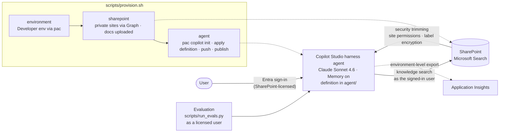

# copilot-studio-agent

A **Microsoft Copilot Studio** agent over your own SharePoint documents, defined as code and
provisioned with one script. Ask a question, get an answer with cited source files, drawn only from
what the **signed-in user** is allowed to see, from an agent that **remembers each user's preferences
across conversations**. It is the Copilot Studio counterpart of
[azd-foundry-search-agent](https://github.com/Metafiziks/azd-foundry-search-agent): same sample
corpus, same eval cases, same protected-mode idea, different platform.

> **Status.** A memory-enabled **harness agent** (Claude Sonnet 4.6), exercised against a real tenant.
>
> - **Working and verified:** one-script provisioning (idempotent), per-user memory, per-user restriction at
>   site and document level, CI with OIDC deploy, telemetry to Application Insights, and a **passing scored
>   eval in CI** with faithfulness scoring by HHEM and an LLM judge (see [Evaluations](#evaluations)).
> - **Not built:** anomaly detection over the telemetry.
> - **Two things will silently break it:** a user without a SharePoint-bearing license, and a brand-new
>   SharePoint site (see [Troubleshooting](#troubleshooting)).

## Architecture



The agent runs entirely inside Copilot Studio: there is no code to host. It is a **harness-type agent**
(`authoringModel: CliCopilot`): the model plans, calls SharePoint search and file tools itself, and keeps
per-user memory. Its model, instructions and memory setting live in
[`agent/settings.mcs.yml`](agent/settings.mcs.yml); the SharePoint knowledge sources are rendered from your
site URLs by [`scripts/render_agent.py`](scripts/render_agent.py); `pac copilot` syncs both.

**SharePoint is the source of truth.** Retrieval runs under the signed-in user's identity, so site
permissions and encrypted sensitivity labels decide what an answer can draw on (see
[protected mode](guides/purview.md)). Memory holds preferences only; documents supply the answers.

> **Every user needs a SharePoint-bearing license.** For a user without one (for example Microsoft 365
> Business Premium) the agent's search tools fail and it says it found nothing. An unlicensed **site owner**
> can still open files by name, so it looks like a missing document. This cost days of misdiagnosis.

## Quick start

**Prerequisites:** the [Power Platform CLI](https://learn.microsoft.com/power-platform/developer/cli/introduction)
(`pac` with `pac copilot`; 2.16 worked) and its .NET runtime, the
[Azure CLI](https://learn.microsoft.com/cli/azure/install-azure-cli), Python 3.10+, and a Microsoft 365
tenant with SharePoint Online. Details: [guides/setup.md](guides/setup.md).

```bash
git clone https://github.com/Metafiziks/copilot-studio-agent && cd copilot-studio-agent
pac auth create --deviceCode --tenant <tenant-id>
az login --tenant <tenant-id> --allow-no-subscriptions     # sign in as the SAME identity
cp .env.example .env                                         # set SP_HOST at minimum
bash scripts/provision.sh --dry-run                          # preview every step
bash scripts/provision.sh
```

| Stage | What happens |
|---|---|
| Preflight | Checks `pac`, `az`, Python and both sign-ins |
| Environment | Creates a Developer environment if missing |
| SharePoint | Creates a private site (a Microsoft 365 group) through Graph, converts `docs/` to `.docx`, uploads it |
| Agent | Creates the harness agent if missing (`pac copilot init`, about 3 minutes), applies `agent/settings.mcs.yml` and the knowledge sources to a workspace rebuilt from the live agent, pushes and publishes |
| Next steps | Prints what a script cannot do: sharing the agent, checking licenses and applying labels |

Then share the agent (Copilot Studio → Share → **Can use**; without it the Agents SDK gets a 404), make sure
each user is SharePoint-licensed, and **wait for SharePoint to index a new site** before asking questions.

Tear down with `bash scripts/teardown.sh --yes --delete-environment`. Groups are deleted **and purged**;
otherwise Entra reserves the site name for 30 days.

## Bring your own documents

Replace `docs/` with your own `.txt` files, adjust the instructions in `agent/settings.mcs.yml`, update
`tests/eval_cases.json`, and re-run `bash scripts/provision.sh`. SharePoint knowledge accepts `.docx`, `.pdf`,
`.pptx` and `.xlsx` (not `.txt`), so text files are converted on upload and cited as `.docx`; or put those
formats straight into the SharePoint library. Sample mode lets every site member read the documents; for
internal knowledge bases use [protected mode](guides/purview.md) (per-user trimming by site permission and
encrypted sensitivity label).

## Evaluations

**Status: passing in CI.** 13 cases from the Azure template (12 document questions, 1 two-turn memory case),
scored on real replies from a licensed test user. `scripts/run_evals.py` calls the agent through Microsoft's
Agents SDK; `eval.yml` runs it in CI. Setup, every run and the analysis behind the scorers are in
[guides/evaluation.md](guides/evaluation.md).

| Metric | Latest CI run | Gate |
|---|---|---|
| Keyword recall | 0.928 | ≥ 0.65 |
| Citation recall | 1.00 | ≥ 0.60 |
| p95 latency | 21.2 s | ≤ 45 s |
| Memory recall | 1.00 | = 1.0 |
| HHEM claim-level mean | 0.811 | ≥ 0.65 |
| LLM judge: share of statements found in the documents | 0.99 | ≥ 0.95 |
| LLM judge: contradicted statements | 0 | 0 |
| LLM judge: faithfulness / relevance / completeness | 1.00 / 1.00 / 1.00 | ≥ 0.85 / 0.85 / 0.60, and no answer below 0.50 |
| Failed calls, scorer errors, scorer self-tests | 0, 0, passed | any failure fails the run |

**Faithfulness** is scored two ways against the source documents in `docs/`:

- **HHEM** (`scripts/hhem.py`, Vectara's open model, runs on CPU with no key) scores each claim. It is strict
  about paraphrase, so it is a trend metric gated on the mean.
- **An LLM judge** (`scripts/judge.py`, any OpenAI-compatible endpoint via `JUDGE_API_KEY`, `gpt-4.1` by
  default) labels each statement stated, added or contradicted. Its 1 to 5 overall scores saturate on
  correct answers, so they only catch regressions.

Each scorer must pass a **self-test** before it scores anything. Both found the agent elaborating beyond the
documents, and tightening its instructions fixed most of it (HHEM 0.61–0.68 → 0.77–0.82; statements found in
the documents 0.92–0.96 → 0.97–0.99), at a small cost in keyword recall (0.986 → about 0.93).
`tests/fixtures/agent_answers.json` keeps the answers from every run, and the `Scorer self-tests` workflow
re-scores them without spending agent credits.

**Copilot Studio's built-in graders** (Agent Evaluation) reject this agent type: every case returns *Error*
and the evaluator never reaches the agent. `scripts/run_evals.py` is the evaluation.

> The caller must be a **real user with a SharePoint-bearing license**, a member of the knowledge site, with
> the agent shared to them: an app-only caller has no user for SharePoint to trim by. A memory case
> **writes into that user's memory**, so use a dedicated test user.

## Memory

**Status: built and verified.** `enableMemory: true` in [`agent/settings.mcs.yml`](agent/settings.mcs.yml).
Copilot Studio's [Memory (preview)](https://learn.microsoft.com/en-us/microsoft-copilot-studio/agents-experience/memory-overview)
lets the agent decide what to keep (preferences, feedback, ongoing work), stored per user and per agent in
Microsoft-managed storage. Memory requires the harness agent type; classic, topic-based agents have no
Memory option.

- **Verified:** a preference told in one conversation was recalled in a new one after about 30 seconds, and
  the two-turn eval case passes (`memory_recall = 1.00`).
- **Not guaranteed to be applied:** the agent acknowledged a "two sentences" preference and then answered in
  one. Memory is the model's judgement, not a rule. Once, in a live eval, it also mixed a stored preference
  ("Line 2, second shift") into a document answer.
- **Limits:** memories are deleted after 28 days of inactivity and cannot be exported; an admin can view or
  delete a user's memories only through a support ticket; turning the toggle off does not delete them
  immediately. It is usage-billed.

## Observability

**Status: verified.** The Power Platform admin center's environment-level export (preview; Manage > Data
export > App Insights, data type *Copilot Studio*) delivers this agent's conversations to Application
Insights as `dependencies` spans: `InvokeAgent` (prompt, reply, model, user) and one `ExecuteTool` per
retrieved document (with its content). Dataverse `conversationtranscripts` also record each conversation,
including the exact tool errors. Query examples, span details and the Azure comparison are in
[guides/observability.md](guides/observability.md).

- **Activation takes hours**, and so do transcripts. An early "no rows" proves nothing: send a marked
  question, then look.
- **The spans carry document text and the user's identity**, with no documented way to turn that off. Do not
  enable it on a protected-mode environment, and restrict read access to the workspace.
- Requires a **Managed Environment** (a premium-license requirement for its users) and Application Insights
  with local authentication on.
- `scripts/provision_observability.sh` creates the workspace and Application Insights; create the export
  itself in the admin center.
- **Not built:** anomaly detection over these spans; the spans expose counts, latency and success, not
  retrieval scores.

## CI/CD

**Status: all workflows verified on GitHub against the harness agent.**

| Workflow | Trigger | What it does |
|---|---|---|
| `ci.yml` | push to `main`, pull requests | Unit tests and shell syntax checks. No tenant access, no secrets |
| `deploy.yml` | push to `main` touching `agent/`, or manual | Signs in with **GitHub OIDC** (`pac auth create --githubFederated`) and runs `provision.sh --skip-sharepoint --no-create` to push and publish |
| `eval.yml` | manual | Runs `scripts/run_evals.py` with HHEM and (with a key) the LLM judge as the test user from the `EVAL_TOKEN_CACHE` secret; uploads the results |
| `scorers.yml` | manual | Scorer self-tests and a re-score of the saved answers: no agent, no tenant access |

One-time setup, all scriptable:

```bash
bash scripts/setup_entra_app.sh --github-repo owner/repo --github-environment dev   # federated credential
pac admin assign-user --environment <url> --user <app-client-id> --application-user --role "System Customizer"
gh api -X PUT repos/owner/repo/environments/dev                                      # the environment name is part of the credential's subject
# Identifying values go in as SECRETS, not variables: variables are printed in clear text in Actions logs,
# which are public on a public repository, while secrets are masked from the first line.
for n in DATAVERSE_ENV_URL EVAL_CLIENT_ID EVAL_TENANT_ID SP_HOST AGENT_ENVIRONMENT_ID; do
  gh secret set "$n" --env dev          # prompts for the value
done
gh variable set KB_ACCESS_MODE --env dev --body protected    # plus KB_SITE_NICK, RESTRICTED_SITE_NICK, AGENT_SCHEMA_NAME
```

- **No client secret** is stored for deploys (OIDC). `scripts/mask_ci_values.sh` also masks the forms the
  platform derives from the secrets (a URL's host, a GUID without dashes).
- **The deploy identity needs `System Customizer`**: the Bot roles are user-level and cannot see an agent
  another user owns.
- **Evals need a user, not the app**, so `eval.yml` uses a stored refresh token for a dedicated test user
  (`EVAL_TOKEN_CACHE`). That breaks on conditional access and idle expiry; refresh it from a local sign-in.
- **Budget the credits.** About 4 Copilot Credits per turn, so a full eval is roughly 60 to 80. Each agent
  has a cap with *Stop usage* in the admin center (Licensing > Copilot Studio > Manage Agents); when it is
  reached the agent stops answering.

Role, OIDC-subject and `pac` publish-quirk details: [guides/ci.md](guides/ci.md).

## Configuration

Set in `.env` (see `.env.example`).

| Variable | Description |
|---|---|
| `SP_HOST` | **Required.** Your SharePoint hostname, e.g. `contoso.sharepoint.com` |
| `KB_ACCESS_MODE` | `sample` (default) or `protected` |
| `ALLOWED_USER` / `DENIED_USER` | Required in protected mode: the two test users |
| `KB_MEMBERS` | Sample mode: extra members of the main site, comma separated |
| `ENV_NAME` / `ENV_REGION` | Environment name (default `copilot-agent-dev`) and macro-region (default `north-america`) |
| `AGENT_NAME` / `PUBLISHER_PREFIX` | Agent display name (default `OL Memory Agent`) and publisher prefix (default `olk`). Together they must give the schema name in `agent/settings.mcs.yml` (`olk_OLMemoryAgent`); the script refuses to apply the definition to a different agent |
| `KB_SITE_NICK` / `KB_SITE_TITLE` | Main site (default `ol-knowledge`) |
| `RESTRICTED_SITE_NICK` / `RESTRICTED_SITE_TITLE` | Restricted site in protected mode (default `ol-restricted`) |
| `EVAL_CLIENT_ID` / `EVAL_TENANT_ID` | Evals: the app registration from `scripts/setup_entra_app.sh` and its tenant |
| `AGENT_ENVIRONMENT_ID` / `AGENT_SCHEMA_NAME` | Evals: the agent to call (the environment ID is in the portal URL; the schema name is `olk_OLMemoryAgent`) |
| `JUDGE_API_KEY` / `JUDGE_BASE_URL` / `JUDGE_MODEL` | Optional LLM judge: key for any OpenAI-compatible endpoint (default `https://api.openai.com/v1`, model `gpt-4.1`). Unset, the judge is skipped and the run says so |
| `AGENT_TOKEN_CACHE` | Evals: the sign-in cache file (default `.build/token_cache.json`). Use a different file per test user |
| `OBS_RESOURCE_GROUP` / `OBS_LOCATION` | Monitoring resource group and region (defaults `rg-copilot-agent-obs`, `eastus2`) |
| `OBS_WORKSPACE` / `OBS_APPINSIGHTS` | Log Analytics workspace and Application Insights names (defaults `log-copilot-agent`, `appi-copilot-agent`) |
| `OBS_DAILY_CAP_GB` / `OBS_RETENTION_DAYS` | Daily ingestion cap (default 1) and retention (default 30) |

## Verification so far

| What | Result |
|---|---|
| Unit tests | 179 pass (`pytest`), covering corpus conversion, agent rendering, the Graph client, shell helpers, provisioning with stub tools, eval metrics and gating, and both scorers with fake models |
| `provision.sh` | Real runs on two environments (clone, apply, push, publish); a second run pushed nothing. The create path (`pac copilot init`) was run by hand; the script's create branch is covered by dry-run tests only |
| Memory | Recalled in a new conversation after about 30 s; eval memory case 1.00 |
| Access restriction | Two users side by side, at site and document level; see [guides/purview.md](guides/purview.md) |
| Licensing | Same agent, same question: answered for a SharePoint-licensed user, "not found" for an unlicensed site owner |
| Evals | Passing in CI with HHEM and the LLM judge; see [Evaluations](#evaluations) |
| GitHub Actions | `ci.yml`, `deploy.yml` (OIDC, idempotent publish), `eval.yml` and `scorers.yml` all green |
| Telemetry | Environment-level export verified on this agent; Dataverse transcripts also hold harness conversations |
| Not evaluated | Purview audit (a tenant-wide compliance setting, left alone) |

## Troubleshooting

| Symptom | Fix |
|---|---|
| `pac: command not found`, or "You must install .NET" | Add `~/.dotnet/tools` to `PATH` and set `DOTNET_ROOT` (Homebrew: `/opt/homebrew/opt/dotnet/libexec`). `pac` 2.16 targets .NET 10; with only .NET 11 installed also set `DOTNET_ROLL_FORWARD=Major` |
| `pac auth` fails with "refresh token has expired" | Idle 90 days. Delete the profile and run `pac auth create --deviceCode` again |
| `pac admin create` rejects `unitedstates` | Pass `--macro-region north-america` (or `europe-uk`, `asia-pacific`); the CLI default is invalid. The scripts do |
| **"I couldn't find that" for every question, and the test pane's trace shows `sharepoint_lexical_search` / `sharepoint_semantic_search` failing with "Knowledge search · unknown"** | **The signed-in user has no SharePoint-bearing license** (for example Business Premium). Assign a license, wait for it to reach search, and test as a licensed user. Microsoft publishes nothing on this for harness agents; it was established by testing |
| Search errors or "no results" for a licensed user on a **brand-new site**, while SharePoint's own search (run as a licensed user) shows the documents | The agent's search was slow to cover a new site: two new sites stayed unusable for hours (transcript error `NotFound in FederationWorkflow`) and worked about 12 hours later, while a new file on an established site was usable in about 10 minutes. Use an established site, or wait. Do not conclude "not indexed" from a search run as an unlicensed user |
| The Agents SDK returns `404 Error discovering conversation endpoints` | The agent is not shared with the signed-in user: Copilot Studio → Share → **Can use** |
| The agent stops answering everyone | Its Copilot Credits cap was reached (admin center: Licensing > Copilot Studio > Manage Agents shows *Over Limit*). Raise the cap or wait for the month to roll over |
| `pac copilot publish` fails "A required argument --bot is missing" | Pass the agent: `pac copilot publish --bot <schema or id>`. The script does |
| `pac` publish fails with `Invalid response format` | A `pac` 2.16.1 status-poller bug after a successful publish; `provision.sh` checks the bot's sync status and passes if the publish succeeded |
| Re-provisioning fails because the site name exists | A deleted group is soft-deleted for 30 days. Use `teardown.sh`, which purges, or purge it in Entra |
| Denied user can open or retrieve a labeled file | The file was labeled before SharePoint could process it. Label a never-labeled file inside SharePoint ([guide](guides/purview.md)) |
| No Sensitivity button in Word for the web | Use the account the label is published to, a normal (not incognito) window, Editing mode; see the guide |
| Deploy fails with `AADSTS700213: No matching federated identity record` | The credential's subject lacks GitHub's immutable owner/repo IDs. Re-run `scripts/setup_entra_app.sh --github-repo owner/repo --github-environment dev` |
| Deploy says the agent was not found (`--no-create`) | The deploying app cannot read it, usually a user-level role; it needs `System Customizer` |
| An eval fails with a scorer self-test or judge error | The scorer could not tell known-good from known-bad answers, or its endpoint failed; the run fails rather than report numbers. Run the `Scorer self-tests` workflow to isolate it |
| SharePoint REST or file download returns 401 | Expected with an Azure CLI token. The scripts use Microsoft Graph |
| `GID: bad math expression` in zsh | `GID` is read-only in zsh; use another variable name |

## Comparison across clouds

|  | [Azure](https://github.com/Metafiziks/azd-foundry-search-agent) | **Copilot Studio (this repo)** | [AWS](https://github.com/Metafiziks/aws-bedrock-agent) | [GCP](https://github.com/Metafiziks/gcp-search-agent) |
|---|---|---|---|---|
| Provision | `azd up` | `bash scripts/provision.sh` | `bash scripts/provision.sh` | `bash scripts/provision.sh` |
| LLM | GPT-5 (Foundry) | Claude Sonnet 4.6, set in `agent/settings.mcs.yml` | Amazon Nova Lite | Gemini 3.5 Flash |
| Agent runtime | Foundry hosted agent (Python) | Copilot Studio harness agent, defined as YAML via `pac` | Bedrock Agents | Google ADK + Cloud Run |
| RAG | Azure AI Search | SharePoint knowledge (Microsoft Search) | Bedrock Knowledge Bases | Vertex AI Search |
| Vector store | AI Search (built in) | Managed by the platform | OpenSearch Serverless | Vertex AI Search (built in) |
| CI auth | Azure OIDC | Entra federated credential (GitHub OIDC) | GitHub OIDC | Workload Identity Federation |
| Eval judge | GPT-5 + HHEM | HHEM + an LLM judge (`gpt-4.1`, claim by claim); built-in Agent Evaluation rejects this agent type | Amazon Nova Pro | Gemini 3.5 Flash |
| Memory | Foundry Memory Store | Copilot Studio Memory (`enableMemory`), per user | Bedrock session-summary memory | ADK session/user state |
| Protected mode | `KB_ACCESS_MODE=purview` | `KB_ACCESS_MODE=protected` | `KB_ACCESS_MODE=protected` | `KB_ACCESS_MODE=protected` |
| Protection mechanism | Purview labels via Foundry IQ | SharePoint permissions + encrypted Purview labels | Knowledge Base document ACLs | Agent Search document ACLs |
| Who proves the user | The user's delegated token, checked by AI Search | The user's Entra sign-in, checked by the platform | Your backend (API Gateway JWT authorizer) | The user's Google token, checked by Agent Search |
| Teardown | `azd down` | `bash scripts/teardown.sh` | `bash scripts/teardown.sh` | `bash scripts/teardown.sh` |

## License

[MIT](LICENSE).
